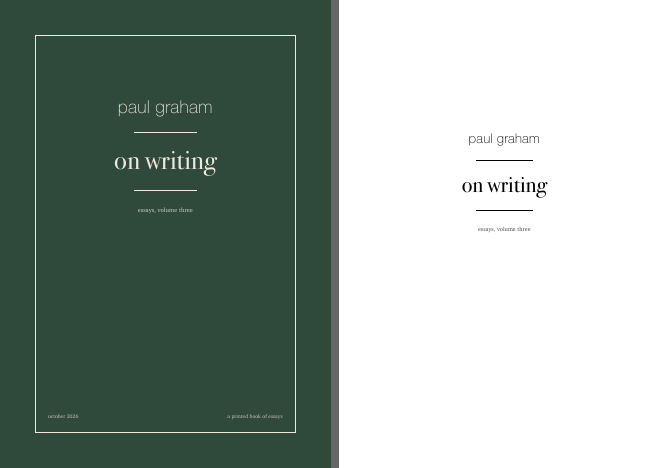

# a printed book of essays

paul graham's essays, printed and bound at home. seven small books. this is
how i made mine, and everything you need to make yours.



## why

there's too much screen. i moved from print to screen like everyone did and
now everything is on it. i'm at a point where i'm choosing to go off it as
much as i can (except when i must work). some essays i read on a screen and
move on. some i want to sit with. breathe. spend time with. the screen isn't
where i have that kind of attention. it's always pulling me somewhere else.

and mira, who's two. she loves books already. i want a home where we don't
only read them, we make them. this one is for me. hers are coming.

i've never bound a book before. there's something in the doing of it, the
printing and punching and sewing, that i want to feel. and then sit in a
corner, or the balcony, and read the thing i made. pencil in hand. looking
up at the clouds now and then. or at the pile of unfinished books, which
only grows.

## paul graham

he just happened to be first. there's so much of his i want to read, enough
for volumes, and it isn't in a book already. and i want to understand how he
writes so simply about things people complicate. startups, wealth, doing
great work. you can't write that simply unless you think that clearly.
that's what i'm trying to learn.

86 essays, seven volumes, sorted by what they're about. [why these, and
what's in each](paul-graham/README.md).

| | | essays | a4 sheets |
|----|----|----|----|
| one | [on work that's yours](paul-graham/pdfs/1-on-work-thats-yours/) | 10 | 38 |
| two | [on kids and learning](paul-graham/pdfs/2-on-kids-and-learning/) | 14 | 34 |
| three | [on writing](paul-graham/pdfs/3-on-writing/) | 12 | 27 |
| four | [on making things](paul-graham/pdfs/4-on-making-things/) | 12 | 39 |
| five | [on startups](paul-graham/pdfs/5-on-startups/) | 13 | 43 |
| six | [on money and investors](paul-graham/pdfs/6-on-money-and-investors/) | 12 | 43 |
| seven | [on society](paul-graham/pdfs/7-on-society/) | 13 | 48 |

## what you can do here

**look.** open a volume folder. `read.pdf` is the whole book on a screen.
`ereader.pdf` is a5, for a kindle or a tablet.

**print one.** `print-odd.pdf` and `print-even.pdf` are the two passes for a
printer that doesn't flip paper (mine doesn't). `print-duplex.pdf` if yours
does. `cover-front.pdf` and `cover-back.pdf` on card or photo paper. then
[the guide](guide/how-to-print-and-bind.md), which walks through the first
time: the two-sheet test, the holes, the sewing. one evening.

**make your own.** which essays, what order, how many volumes:
`paul-graham/volumes.py`. cover colour, margins, type: the top of
`tool/styles.css`. then:

```sh
npm install                              # once. also needs chrome, ghostscript, poppler
python3 tool/fetch.py paul-graham 3      # only if you added an essay the repo doesn't have
python3 tool/build.py paul-graham 3
node tool/make-pdf.mjs paul-graham 3     # → paul-graham/pdfs/3-on-writing/
```

or clone it and tell your agent what you want. [AGENTS.md](AGENTS.md)
explains the repo to it.

## paper and ink

a4 80gsm for the inside, i use a pale green. 260gsm glossy photo paper for
the covers. an epson l8050, which doesn't duplex. any tinted 80-100gsm
works inside, and 250gsm card works for covers. a 100-sheet pack is two
volumes.

the fonts are charter, bodoni 72, and helvetica neue, which come with a
mac. [guide/fonts.md](guide/fonts.md) has free ones that sit close if
you're not on one.

## other authors

one folder per author: `volumes.py`, `parse.py` for that site's html, a
readme. the engine, the covers, and the guide are shared. pg is first. not
last.

## the essays are theirs

paul graham's are free at [paulgraham.com](https://www.paulgraham.com/articles.html).
they're here so you can print them for yourself. read them, bind them, give
one to a friend. don't sell them. the tool and the layout are mit,
see [LICENSE](LICENSE).

---

just pay attention to the breath. and every time a thought arises, notice
it, and return to the breath.
